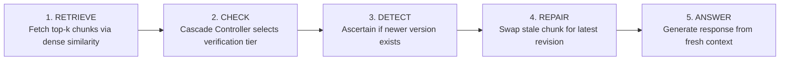

# Stale-Aware RAG over Versioned Documents

[](https://www.python.org/)
[](LICENSE)
[](#architecture)
[](FIRST_DELIVERABLE.md)

> **B.Tech. in Computer Science & Engineering (AI & ML)**  
> **Semester V — Mini Project Review & Capstone**  
> **Project Team:**  
> • **Kaustubh Akash**  
> • **Janhavi Rajpurohit**  
> • **Kasissnu Ssinha**  
> • **Chris John Paul**  

---

## 📌 Executive Summary

Retrieval-Augmented Generation (RAG) is prone to a critical, silent failure mode: **dense vector bi-encoders retrieve the most semantically similar chunk, not the most current one.** When documentation undergoes versioning, historical chunks and current chunks share near-identical phrasing, structure, and vocabulary. Consequently, older, superseded answers routinely outrank newer revisions.

**Stale-Aware RAG** introduces a verification and repair stage between retrieval and generation. Using an **adaptive cost-aware cascade**, the pipeline detects obsolete chunks at the lowest sufficient compute tier and repairs them by hot-swapping them with their latest authoritative revisions.

---

## 🚨 The Problem: Similarity $\neq$ Currency

```
USER QUERY: "What is the return window for this product today?"

[v1 · 2023 · RETRIEVED]  "Returns accepted within 30 days."  [Cosine Similarity: 0.92]
[v3 · 2026 · MISSED]     "Returns accepted within 7 days."   [Cosine Similarity: 0.89]

MODEL OUTPUT: "Returns are accepted within 30 days."
❌ Result: Fluent, confident, and completely out of date.
```

Standard RAG pipelines have no built-in temporal arbitration:
1. **Silent Degradation:** The LLM receives outdated text that matches the query well, answering with high certainty but false information.
2. **Brute-Force Verification is Too Costly:** Invoking an LLM to check every retrieved passage incurs prohibitive latency and API token cost.
3. **Naive Recency Filtering Drops Context:** Filtering purely by timestamp drops unrevised yet still-valid historical documents, hurting recall.

---

## 💡 The Solution: Stale-Aware RAG Pipeline



### The Cost-Aware Verification Cascade

| Tier | Mechanism | Compute Cost | Latency | When Activated |
|---|---|---|---|---|
| **Tier 1: Metadata Check** | Canonical URI & Release Timestamp | ~0 cost (O(1) lookup) | < 1 ms | Distinct version tag or release date attached |
| **Tier 2: Heuristic Diff** | Section hash & fast textual diffing | Negligible (CPU diff) | ~5 ms | URI matches but text differs across releases |
| **Tier 3: Micro-LLM Arbiter** | Lightweight 7B/8B model verification | Moderate (Token inference) | ~150 ms | High ambiguity or multi-version semantic shifts |

---

## 🔬 Experimental Evaluation Plan

Four systems are evaluated on identical temporal QA question sets across four real-world versioned datasets:

1. **System A (Plain RAG):** Baseline dense retrieval without currency checking.
2. **System B (Recency Filter):** Naive chronological filter discarding non-latest documents.
3. **System C (Always Full Check):** Full LLM verification on all retrieved chunks (upper bound accuracy, high compute cost).
4. **System D (Our Cascade):** Adaptive multi-tier cascade aiming to match System C's accuracy at a fraction of the cost.

### Benchmark Datasets
- **Python Documentation:** Library documentation across consecutive releases (functions added, deprecated, removed).
- **Kubernetes Concepts & API Docs:** Rapidly evolving cloud orchestration specifications.
- **Wikipedia Revisions:** Historical article snapshots capturing factual updates over time.
- **STALE Benchmark:** Curated multi-turn conversational memory conflicts (MIT License).

---

## 📁 Repository Structure

```plaintext
stale-aware-rag/
├── README.md                      # Main project landing page (this document)
├── FIRST_DELIVERABLE.md           # The strict 1-page "Why" and "What" deliverable (Markdown)
├── First_Deliverable_One_Pager.pdf# Formatted 1-page PDF document (print/submit-ready)
├── First_Deliverable_One_Pager.docx# Formatted 1-page Word document
├── PROBLEM_STATEMENT.md           # In-depth formal problem statement & boundary definitions
├── docs/
│   ├── DEMO_GUIDELINES.md         # Instructions and rubric for the live application demo
│   └── IEEE_REPORT_TEMPLATE.md    # Starter structure for the 10-page Mini Project Report
├── generate_pdf.py                # Script to regenerate the 1-page PDF
├── generate_docx.py               # Script to regenerate the 1-page DOCX
└── src/                           # Source code (W1-W3 implementation modules)
    ├── __init__.py
    ├── indexer.py                 # Versioned chunk indexing with metadata
    ├── retriever.py               # Top-k dense similarity retrieval
    ├── cascade.py                 # Multi-tier cost-aware currency checker
    └── repair.py                  # Context repair and LLM prompt builder
```

---

## 🗓️ 3-Week Implementation Roadmap

- **Week 1: Data & Baseline Pipeline**
  - Ingest versioned documentation (Python, Kubernetes, Wikipedia, STALE).
  - Construct vector index storing version IDs, release timestamps, and canonical URIs.
  - Implement baseline Plain RAG and Recency Filter RAG.
- **Week 2: Detection & Context Repair**
  - Implement Tier 1 (Metadata) and Tier 2 (Chunk Diff) detection modules.
  - Build the automated replacement/repair mechanism for obsolete retrieved chunks.
  - Benchmark detection recall and precision against ground-truth revisions.
- **Week 3: Cascade Optimization & Comprehensive Evaluation**
  - Integrate Tier 3 Micro-LLM arbiter and dynamic cascade controller.
  - Generate Pareto evaluation plot: Factual Accuracy vs. Verification Cost.
  - Finalize 10-page IEEE Mini Project Report and stage Live Demo.

---

## 🚀 How to Run

### Prerequisites
```bash
python -m venv venv
# On Windows:
.\venv\Scripts\activate
# On Linux/macOS:
source venv/bin/activate
pip install -r requirements.txt
```

### Build Deliverables
```bash
# Rebuild the 1-page First Deliverable PDF:
python generate_pdf.py

# Rebuild the 1-page First Deliverable Word Document:
python generate_docx.py
```

---

## 👥 Project Team

| Name | Role | Responsibilities |
|---|---|---|
| **Kaustubh Akash** | Project Lead / RAG Architect | Cascade controller design & pipeline integration |
| **Janhavi Rajpurohit** | Data & Evaluation Engineer | Versioned corpus construction & temporal QA benchmark |
| **Kasissnu Ssinha** | Retrieval & Indexing Specialist | Dense bi-encoder indexing & metadata schema |
| **Chris John Paul** | Verification & LLM Engineer | Micro-LLM arbiter & context repair operator |
